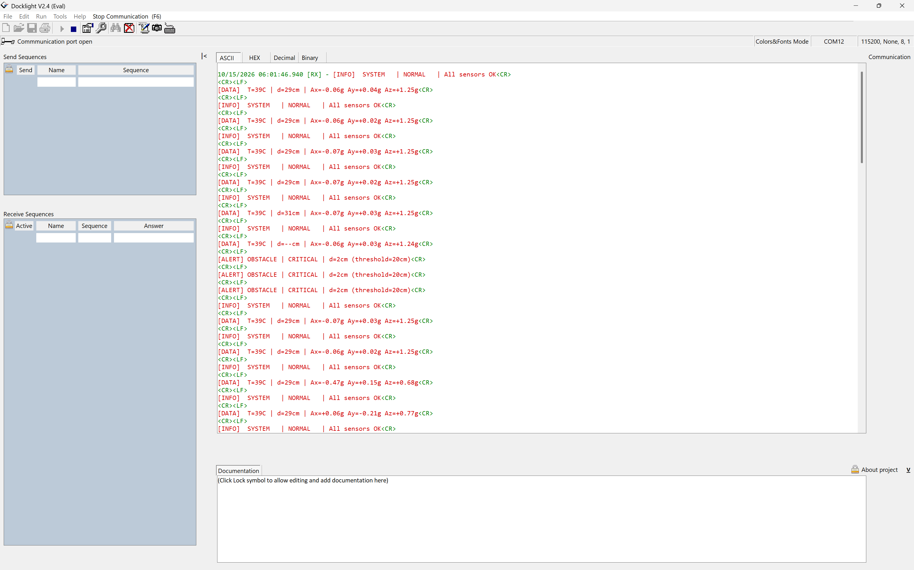

# Vehicle Event Logging and Response System

An STM32F411CEU6 (ARM Cortex-M4) based vehicle monitor, written as bare-metal register-level C with no HAL. It reads three sensors, classifies each reading as Normal, Warning, Critical or Invalid, and sends structured alerts to a PC over UART.

| Sensor | Measures | Interface |
|---|---|---|
| MPU6050 | Impact / motion (accelerometer + gyroscope) | I²C (bit-banged, PB6/PB7) |
| LM35 | Temperature | ADC1, PA0 |
| HC-SR04 | Obstacle distance | GPIO + DWT cycle counter, PB0/PB1 |

A PB12 push-button raises a hardware emergency interrupt (EXTI), and the on-board LED on PC13 shows system status.

---

## Academic Details and Acknowledgement

**Student Name(s) and Registration Number(s):**

| Registration No. | Name |
|---|---|
| CB.SC.U4CSE24502 | Aniruth Karthik |
| CB.SC.U4CSE24513 | Jaikrrish S |
| CB.SC.U4CSE24521 | Krishanth K |
| CB.SC.U4CSE24550 | Srisanth P A |

**Mentor:** Dr. A. Baskar<br>
**Course:** 23CSE304 - Embedded System<br>
**Department:** Department of Computer Science and Engineering<br>
**Institution:** School of Computing, Amrita Vishwa Vidyapeetham, Coimbatore, India.

---

## Demo [Video & image]

### Demonstration video


https://github.com/user-attachments/assets/60057de4-fd58-4113-ab0b-e600b5577593


If the player does not load, open the video directly: [submission/video.mp4](submission/video.mp4).

### Live output on the PC terminal

The board's UART output captured in Docklight (COM12, 115200 baud, 8-N-1):



What the capture shows:

- `[INFO] SYSTEM | NORMAL | All sensors OK` heartbeat about once per second.
- `[DATA]` telemetry lines with temperature, distance and acceleration, for example `T=39C | d=29cm | Ax=-0.06g Ay=+0.04g Az=+1.25g`.
- `d=--cm` when the HC-SR04 returns no valid echo (an invalid reading, which raises no alert).
- `[ALERT] OBSTACLE | CRITICAL | d=2cm (threshold=20cm)` when an object comes within 20 cm, followed by a return to normal telemetry once it is removed.

---

## How It Works

```
 LM35 ------> PA0 / ADC1 --+
 HC-SR04 ---> PB0 / PB1 ---+--> Sensor drivers --> Classifier --> Event manager --> UART --> PC terminal
 MPU6050 ---> PB6 / PB7 ---+                                            |
 SOS button-> PB12 / EXTI ----------------------------------------------+--> PC13 LED
```

The firmware is a cooperative super-loop with a 100 ms period: read LM35, read HC-SR04, read MPU6050, send alerts and telemetry, then delay. Alerts repeat every 5th loop while a fault persists, and the normal heartbeat is sent every 10th loop.

### Event thresholds

All thresholds are defined in [`config.h`](config.h).

| Sensor | Warning | Critical | Invalid |
|---|---|---|---|
| Temperature | ≥ 45 °C | ≥ 60 °C | — |
| Distance | ≤ 35 cm | ≤ 20 cm | Timeout or outside 2–400 cm |
| Motion (change from baseline) | ≥ 0.80 g | ≥ 1.50 g | I²C read failure |

### UART protocol

115200 baud, 8 data bits, no parity, 1 stop bit. Each character is mirrored on PA9 (USART1), PA2 (USART2) and software UART pins PB10 and PB4.

```
[INFO]  SYSTEM   | BOOT     | Vehicle Event Monitor v1.0
[ALERT] MOTION   | CRITICAL | Ax=+1.82g Ay=-0.12g Az=+0.03g
[ALERT] TEMP     | CRITICAL | T=73C (threshold=60C)
[ALERT] OBSTACLE | CRITICAL | d=14cm (threshold=20cm)
[ALERT] EXTI     | CRITICAL | Hardware Emergency Interrupt fired on PB12!
[INFO]  SYSTEM   | NORMAL   | All sensors OK
[DATA]  T=26C | d=31cm | Ax=+0.01g Ay=-0.02g Az=+0.00g
```

---

## Hardware and Pin Map

| Signal | Pin | Notes |
|---|---|---|
| LM35 output | PA0 | ADC1_IN0 |
| HC-SR04 TRIG | PB0 | GPIO output |
| HC-SR04 ECHO | PB1 | 5 V-tolerant, wired directly |
| MPU6050 SCL / SDA | PB6 / PB7 | AD0 to GND gives address 0x68 |
| UART TX | PA9, PA2, PB10, PB4 | Same data on all four |
| Status LED | PC13 | Active LOW; 1 Hz heartbeat, 10 Hz strobe when critical |
| Emergency input | PB12 | Falling-edge EXTI, internal pull-up |

---

## Build, Flash and Run

1. In Keil µVision, create a project for the **STM32F411CEUx** and add `main.c` and `config.h`.
2. Enable the standard C library so `snprintf` works.
3. Build and flash through ST-Link (SWD).
4. Connect a USB-to-UART adapter RX to **PA9** (or PA2 / PB10 / PB4), and GND to GND.
5. Open Docklight, PuTTY or CoolTerm at **115200, 8-N-1**.
6. Reset the board. You should see the boot banner, then heartbeat and telemetry lines.

To run a single-sensor bring-up test, add [`hrc_test.c`](hrc_test.c) (HC-SR04) or [`mpu6050_test.c`](mpu6050_test.c) (MPU6050) in place of `main.c`.

---

## Repository Contents

| Path | Description |
|---|---|
| [`main.c`](main.c) | Application firmware: drivers, classifier, alerts, main loop |
| [`config.h`](config.h) | Pin assignments, thresholds, `EventState` enum |
| [`hrc_test.c`](hrc_test.c) | HC-SR04 standalone test with pin-pair auto-scan |
| [`mpu6050_test.c`](mpu6050_test.c) | MPU6050 standalone test with pin and address auto-probe |
| [`PRD_Vehicle_Event_Logging.md`](PRD_Vehicle_Event_Logging.md) | Product requirements document |
| [`Vehicle_Event_Logging_Response_System_Plan.md`](Vehicle_Event_Logging_Response_System_Plan.md) | Original project plan and bill of materials |
| [`team11_report.pdf`](team11_report.pdf), [`REPORT.md`](REPORT.md), [`REPORT.tex`](REPORT.tex) | Full case-study report |
| [`team11.pptx`](team11.pptx) | Presentation slides |
| [`submission/`](submission) | Demo video and terminal screenshot |
